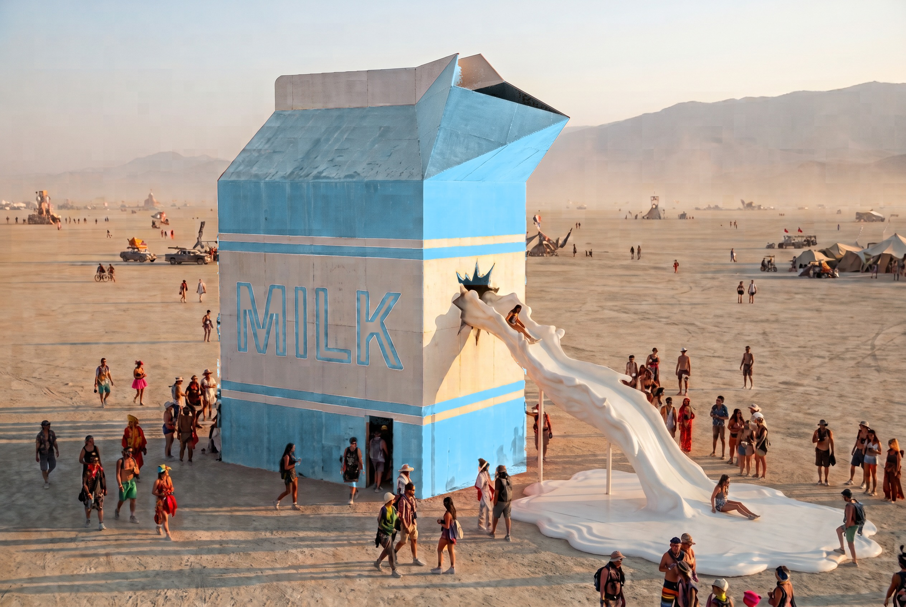
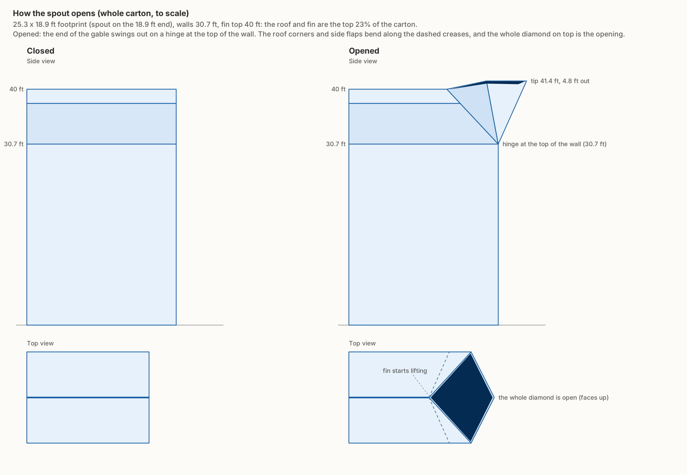
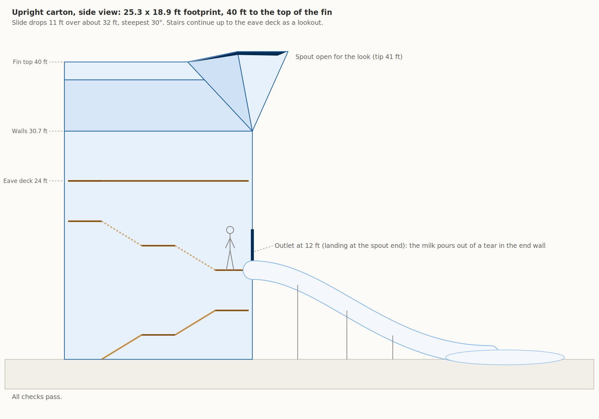
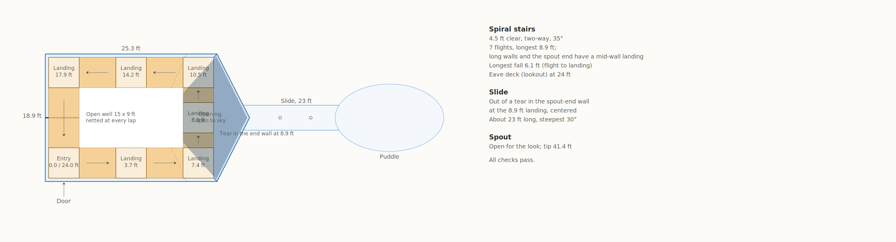

# Spilt Milk

A wood-built, burnable milk carton for Burning Man, standing upright with its spout
pulled open. Milk spills out as a slide, and the inside is a railed staircase that
spirals up the walls. (The earlier tipped-over design is kept under `outputs/tipped/`
and `config/tipped.json`; see `docs/design-decisions.md` for why it changed.)

This repo holds the design notes and a small Python program that draws the
schematics from a set of parameters, so a change (tilt, stair width, slide
shape) is one edit away and the numbers stay consistent with the drawings.
The same repo tracks the 2027 project: key dates, grants, budget, and sourcing.








## Project tracking

Co-leads are Allison Jacobs and Quentin Helgren. The shared Google Calendar
named "Spilt Milk" is the live date source.
[docs/key-dates.md](docs/key-dates.md) is a snapshot last synced October 8, 2026.
Times below are Pacific.

**Next deadlines:**

| When | Track | What |
|---|---|---|
| Wed Oct 14, 4:00–5:30pm PT | Honoraria | BRC Honoraria LOI Q&A (RSVP) |
| Thu Oct 15, 11:59am PT | Art Grant | CCI Quick Grant due (up to $600) |
| Thu Oct 15, all day | Art Grant | Rbhu Gives Back applications close |
| Thu Oct 22, 10:00–11:30am PT | Honoraria | BRC Honoraria LOI Q&A (second session) |
| Thu Oct 29, 5:00pm PDT | Honoraria | 2027 BRC Honoraria letter of intent due |

Later dates, including the approximate Mutant Vehicle windows, are in the key
dates doc. Also: [docs/funding.md](docs/funding.md),
[docs/budget.md](docs/budget.md),
[docs/open-decisions.md](docs/open-decisions.md),
[docs/fundraising.md](docs/fundraising.md),
[docs/materials.md](docs/materials.md).
Design questions stay in [docs/open-questions.md](docs/open-questions.md).

## Quick start

No dependencies are needed to generate the SVGs (Python 3.10+).

```bash
PYTHONPATH=src python3 -m milk_carton              # upright: spout, side views, plan, report.md
PYTHONPATH=src python3 -m milk_carton --config config/tipped.json --out outputs/tipped   # the old tipped design
PYTHONPATH=src python3 -m milk_carton --png        # also PNGs (pip install cairosvg)
PYTHONPATH=src python3 -m milk_carton --sweep      # adds the stair width x landing interval table
PYTHONPATH=src python3 -m milk_carton --set tilt_deg=45 --set stair_width_ft=4 --out /tmp/try
PYTHONPATH=src python3 -m milk_carton --config config/default.json
```

Or install it (`pip install -e ".[dev]"`) and run `milk-carton` and `pytest`.
The command exits non-zero when a stair check fails, so it is safe to use in CI.

## What is in here

| Path | What |
|---|---|
| `src/milk_carton/config.py` | Every parameter, in feet and degrees. `config/default.json` mirrors it. |
| `src/milk_carton/geometry.py` | Carton shell, tilt transform, climbing surfaces, spout, slide path. |
| `src/milk_carton/stairs.py` | Zigzag stair layout plus the checks (pitch, clearance, headroom, fit). |
| `src/milk_carton/upright.py` | Upright carton: spout geometry, spiral stairs and checks, both slide options, drawings. |
| `src/milk_carton/spout_figure.py` | The "how the spout opens" explainer, drawn from the same model. |
| `src/milk_carton/zigzag.py` | Diagonal /\/\ stairs for the tipped design (shows why they do not fit). |
| `src/milk_carton/elevation.py`, `plan.py` | Tipped design: side view and stair plan. |
| `tests/` | Locks in the key dimensions and the stair findings. |
| `docs/design-decisions.md` | What is decided, what is assumed, and how we got here. |
| `docs/stair-analysis.md` | Why the stairs look the way they do, with the width sweep. |
| `docs/open-questions.md` | What still needs an answer (several need an engineer). |
| `docs/image-prompts.md` | Prompts for Gemini and other image generators. |
| `docs/key-dates.md` | Snapshot of the shared Spilt Milk calendar. Live source is still the calendar. |
| `docs/funding.md` | Honoraria, Rbhu Gives Back, CCI Quick Grant, and Zellerbach. |
| `docs/budget.md` | Working ~$80k total. Named line items are TBD, not guessed. |
| `docs/open-decisions.md` | LLC vs fiscal sponsor. Not legal advice. |
| `docs/fundraising.md` | Dairy partner tracker. No outreach sent yet. |
| `docs/dairy-partner-shortlist.md` | Full Bay Area dairy shortlist behind the tracker. |
| `docs/materials.md` | Lumber sources and burn / treated-wood flags. |
| `docs/lumber-shortlist.md` | Full Bay Area lumber shortlist behind the summary. |
| `outputs/` | Generated drawings and report (committed so they show on GitHub). |

## Status

Concept stage. These are schematics for planning and for the Black Rock City honoraria
letter of intent, not engineering drawings. Dimensions are scaled from a real
half-gallon carton and need to be checked. The structure, the slide, the stairs and
the railings all need review by a structural engineer and by BRC art safety.

## Automation

- `make run` redraws everything; `make test` runs the tests; `make publish` creates the GitHub repo and pushes.
- `scripts/publish.sh [name] [--private|--public]` does `git init`, commits, creates the repo with the
  GitHub CLI and pushes. Sign in once with `gh auth login` first.
- `.github/workflows/schematics.yml` runs on every push to `main` that touches `src/`, `config/` or `tests/`.
  It runs the tests, redraws `outputs/` from `config/default.json`, commits the new drawings, and fails
  the run if a stair check fails. Edit the config on GitHub, and the drawings update on their own.

## Claude skill

`make skill` builds `dist/milk-carton-schematics.skill`: the generator, the docs and the default config
packaged so Claude can redraw and check the schematics in any chat. Upload or save it in Claude (the file
card shows a Save skill button when your org allows it). Rebuild it whenever `src/`, `docs/` or
`config/default.json` change; the CI workflow also attaches a fresh build to every run.

## Putting this on GitHub

The one-command way: `scripts/publish.sh`. The manual way:

```bash
cd milk-carton
git init -b main
git add .
git commit -m "Initial milk carton schematic generator and design notes"
gh repo create milk-carton --private --source=. --push     # or create it on github.com and add the remote
```
